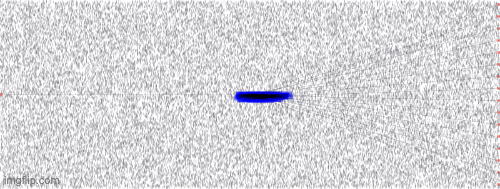

<p align="center">
  
</p>

<h1 align="center">Apollo</h1>

<p align="center">
  <strong>Automated Routing-Informed Placement for Large-Scale Photonic Integrated Circuits</strong>
</p>

<p align="center">
  <a href="https://doi.org/10.1109/ICCAD66269.2025.11240728">Paper</a> |
  <a href="https://arxiv.org/abs/2504.18813">arXiv</a> |
  <a href="https://scopex-asu.github.io/files/publications/PD_ICCAD2025_Gu.pdf">PDF</a> |
  <a href="https://scopex-asu.github.io/files/publications/PD_ICCAD2025_Gu_slides.pdf">Slides</a>
</p>

Apollo is a GPU-accelerated, routing-informed placement framework for large-scale photonic integrated circuits (PICs). It incorporates photonic-specific physical constraints—including port orientation, waveguide bend radius, routing congestion, crossings, alignment, and spacing—directly into placement optimization.

This repository currently contains the benchmark release used in the Apollo paper. The executable placement engine is not included in the current release.

## Highlights

- A LEF/DEF-inspired YAML format extended for photonic components, ports, waveguides, and placement constraints.
- Twelve benchmark configurations derived from Clements-style MZI meshes and ADEPT photonic tensor cores.
- Compact (`S`) and relaxed (`L`) die-area variants for evaluating placement under different area budgets.
- Designs ranging from 60 to 1,201 instances and from 87 to 1,791 optical nets.
- Compatibility-oriented data for PIC layout flows such as GDSFactory and detailed routing with [LiDAR](https://github.com/ScopeX-ASU/LiDAR).

<!-- Apollo achieves a geometric-mean routing success rate of **94.79%** across the benchmarks reported in the paper while generating layouts within minutes. -->

## Placement Example

<p align="center">
  
</p>

## Benchmark Suite

All dimensions below are in micrometers. `S` denotes the smaller, more constrained die area, while `L` denotes the larger die-area variant.

| Topology | Scale | Instances | Nets | `S` die area | `L` die area |
| --- | ---: | ---: | ---: | ---: | ---: |
| Clements | 8 x 8 | 60 | 87 | 3000 x 800 | 4000 x 1200 |
| Clements | 16 x 16 | 184 | 303 | 5800 x 1600 | 6800 x 2000 |
| ADEPT | 8 x 8 | 104 | 127 | 3200 x 900 | 3200 x 1200 |
| ADEPT | 16 x 16 | 227 | 319 | 5300 x 2000 | 6000 x 2000 |
| ADEPT | 32 x 32 | 529 | 767 | 6500 x 3300 | 7000 x 3600 |
| ADEPT | 64 x 64 | 1,201 | 1,791 | 7800 x 6500 | 8500 x 7000 |

<!-- The directory name encodes the topology, scale, and die-area variant:

```text
benchmarks/<topology>_<rows>x<columns>_<S|L>/
```

For example, `benchmarks/adept_32x32_S/` contains the compact 32 x 32 ADEPT benchmark. The `settings.design` field inside each YAML file is the authoritative design identifier. Note that the file in `benchmarks/clements_16x16_L/` is currently named `adept_16x16.yml`; its directory and `settings.design` value identify it as the large Clements design. -->

## Repository Layout

```text
Apollo/
├── benchmarks/          # Clements and ADEPT benchmark YAML files
├── configs/
│   └── config.json      # Example benchmark selection
├── figs/                # Logo and placement animations
├── params/
│   ├── Params.py        # Configuration helper classes
│   └── params.json      # Placement parameter defaults and descriptions
├── read_benchmark.py    # Example config and benchmark reader
└── README.md
```

## Benchmark Format

Each YAML benchmark contains the following top-level sections:

| Section | Description |
| --- | --- |
| `instances` | Component types, component settings, initial locations, orientations, and placement status |
| `schematic_placements` | Placement information inherited from the source schematic |
| `nets` | Optical connectivity between component ports |
| `ports` | Top-level design ports, when present |
| `settings` | Design name, units, die area, instance/net counts, bend radius, and routing-grid settings |
| `library` | Macro geometry, insertion loss, layer information, and pin offsets/orientations |
| `constraints` | Groups of instances subject to layout constraints such as left or center alignment |
| `symmetry_nets` | Net pairs used to describe structural symmetry |

The format uses one distance unit per micrometer (`units_distance_microns: 1`). Instance placements follow this shape:

```yaml
placement:
  - UNPLACED             # placement status
  - [40, 448.75]         # x/y location
  - N                    # orientation
  - [0, 0, 0, 0]        # placement halo
```

## Using the Benchmarks

Choose a YAML file from `benchmarks/` and set its path in `configs/config.json`. The config expects `yaml_input` to be a one-element list. `params/params.json` documents the available base parameters, their default values, and their descriptions. Users can add or override parameters in `configs/config.json` according to the needs of their placer. The included configuration selects the compact ADEPT 8 x 8 benchmark:

```json
{
  "yaml_input": ["benchmarks/adept_8x8_S/adept_8x8.yml"]
}
```

When loaded with `Params.py`, any omitted base parameters retain the defaults defined in `params/params.json`.

The YAML file contains the complete design description, including instances, nets, component geometry, port orientations, die area, routing settings, and placement constraints.

Install the two helper dependencies, then run the included example to load both files and print a benchmark summary:

```bash
python -m pip install pyyaml multimethod
python read_benchmark.py
```

## Paper

Apollo was published at the **2025 IEEE/ACM International Conference on Computer-Aided Design (ICCAD)**:

> Hongjian Zhou, Haoyu Yang, Nicholas Gangi, Zhaoran (Rena) Huang, Haoxing Ren, and Jiaqi Gu. “Apollo: Automated Routing-Informed Placement for Large-Scale Photonic Integrated Circuits.” ICCAD, 2025.

If you use Apollo or its benchmarks in your research, please cite:

```bibtex
@inproceedings{zhou2025apollo,
  author    = {Hongjian Zhou and Haoyu Yang and Nicholas Gangi and
               Zhaoran {Rena} Huang and Haoxing Ren and Jiaqi Gu},
  title     = {Apollo: Automated Routing-Informed Placement for Large-Scale
               Photonic Integrated Circuits},
  booktitle = {2025 IEEE/ACM International Conference on Computer-Aided Design (ICCAD)},
  year      = {2025},
  pages     = {1--9},
  doi       = {10.1109/ICCAD66269.2025.11240728}
}
```

## Authors

Hongjian Zhou, Haoyu Yang, Nicholas Gangi, Zhaoran (Rena) Huang, Haoxing Ren, and [Jiaqi Gu](https://scopex-asu.github.io/).

For questions about the benchmarks or the paper, please open a GitHub issue or contact the authors.

## License

This repository does not currently include a license file. Until a license is provided, the contents remain under their authors' copyright; contact the authors for reuse terms beyond applicable exceptions.
